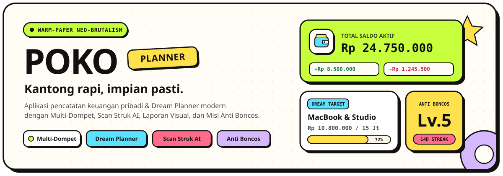
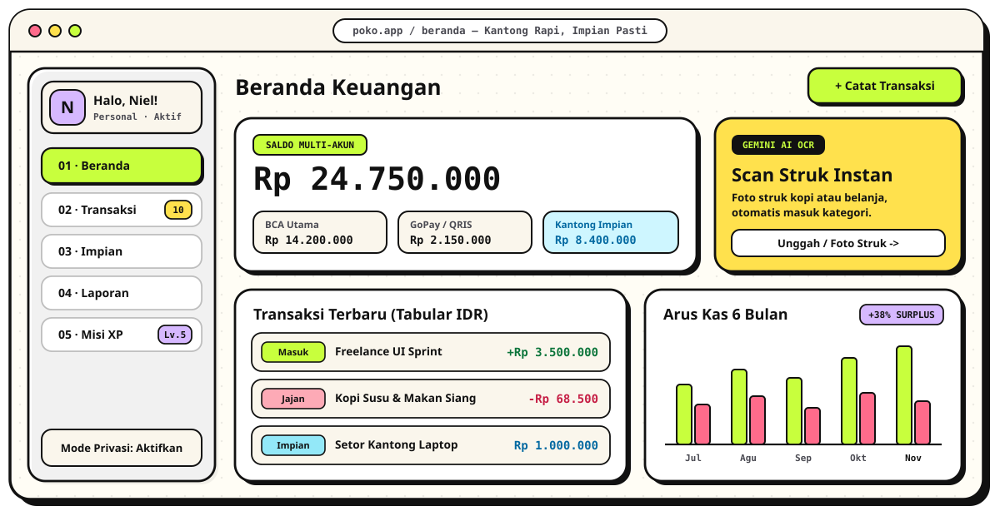
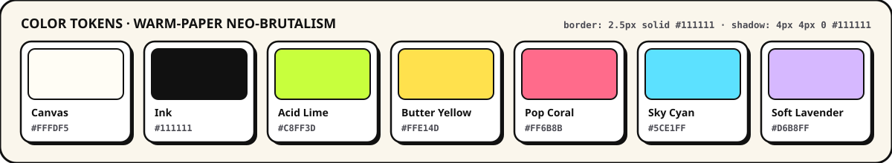
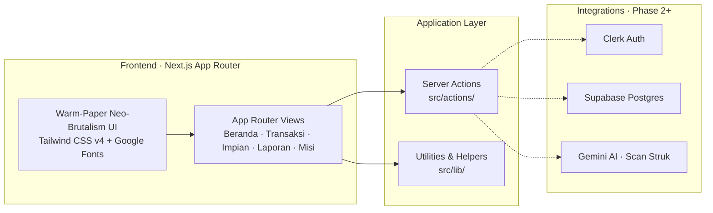

<div align="center">

<a href="#pratinjau-antarmuka">
  
</a>

<br />
<br />

<p>
  
  
  
  
  
</p>

<h3>Kantong rapi, impian pasti.</h3>

<p>
  Aplikasi pencatatan keuangan pribadi &amp; <strong>Dream Planner</strong> bergaya
  <strong>Warm-Paper Neo-Brutalism</strong> — taktil, ekspresif, bebas ribet, dan bikin nabung
  terasa seperti main game.
</p>

<p>
  <a href="#pratinjau-antarmuka"><strong>Pratinjau UI</strong></a> ·
  <a href="#fitur-unggulan"><strong>Fitur</strong></a> ·
  <a href="#design-system"><strong>Design System</strong></a> ·
  <a href="#arsitektur--tech-stack"><strong>Arsitektur</strong></a> ·
  <a href="#mulai-di-lokal"><strong>Quick Start</strong></a> ·
  <a href="#roadmap"><strong>Roadmap</strong></a>
</p>

</div>

---

## Kenapa Poko?

Kebanyakan aplikasi keuangan terasa seperti _spreadsheet_ kantor yang kaku — dingin, membosankan, dan bikin malas mencatat pengeluaran di hari ke-3.

**Poko Planner** membalik pengalaman itu:

- **Tactile & Playful** — Permukaan kertas hangat (`#FFFDF5`), garis tinta tegas (`2.5px solid #111111`), dan _hard offset shadow_ yang terasa hidup saat ditekan.
- **Dibuat untuk Rupiah (IDR)** — Semua nominal menggunakan `JetBrains Mono` dengan `tabular-nums` sehingga kolom pemasukan, pengeluaran, dan target tabungan selalu sejajar presisi.
- **Berorientasi Impian** — Setiap rupiah yang kamu sisihkan terhubung langsung ke **Kantong Impian**, bukan sekadar angka dingin di mutasi rekening.

---

## Pratinjau Antarmuka

<div align="center">
  
</div>

<br />

Poko dirancang dengan **5 ruang utama** dalam tata letak Bento yang responsif (sidebar di desktop, bottom bar taktil di mobile):

|  #   | Ruang                  | Fokus Utama                                                                                                         |
| :--: | :--------------------- | :------------------------------------------------------------------------------------------------------------------ |
| `01` | **Beranda**            | Total saldo lintas dompet, ringkasan arus kas bulanan, kartu cepat _Scan Struk AI_, dan aksi catat transaksi cepat. |
| `02` | **Transaksi**          | Pencatatan Pemasukan, Pengeluaran, & Transfer antar dompet dengan filter cepat dan nominal tabular IDR.             |
| `03` | **Impian & Tabungan**  | _Dream Planner_ dengan progress bar taktil, simulasi target bulanan, dan setor/tarik tersinkron ke dompet.          |
| `04` | **Laporan**            | Visualisasi arus kas 6 bulan, proporsi kategori pengeluaran, dan rasio surplus bulanan.                             |
| `05` | **Misi & Anti Boncos** | Sistem XP, level (`Lv.1`–`Lv.10+`), _daily streak_, dan tantangan hemat agar kebiasaan finansial konsisten.         |

> [!TIP]
> Ingin melihat prototipe interaktif penuh sebelum migrasi fitur ke Next.js selesai? Buka langsung [`poko.html`](./poko.html) di browser kamu.

---

## Fitur Unggulan

<table>
  <tr>
    <td width="50%" valign="top">
      <h3>Dompet Multi-Akun</h3>
      Kelola saldo Bank (BCA, Mandiri, Jago), E-Wallet (GoPay, OVO, Dana, QRIS), dan Uang Tunai dalam satu layar tanpa bingung duplikasi transfer.
    </td>
    <td width="50%" valign="top">
      <h3>Dream Planner Tersinkron</h3>
      Buat target impian (laptop, dana darurat, konser, liburan) dengan progress real-time yang otomatis terhubung dengan mutasi dompet.
    </td>
  </tr>
  <tr>
    <td width="50%" valign="top">
      <h3>Scan Struk AI (Gemini)</h3>
      Foto struk kopi atau belanja harian — ekstraksi item, nominal, dan kategori otomatis tanpa ketik manual satu per satu.
    </td>
    <td width="50%" valign="top">
      <h3>Laporan Arus Kas Visual</h3>
      Pantau tren pemasukan vs pengeluaran 6 bulan terakhir, rincian kategori terbesar, dan rasio surplus bulanan dalam grafik yang mudah dipahami.
    </td>
  </tr>
  <tr>
    <td width="50%" valign="top">
      <h3>Mode Privasi Sekali Klik</h3>
      Sedang buka Poko di kafe atau kereta? Aktifkan <strong>Mode Privasi</strong> untuk menyamarkan seluruh nominal Rupiah secara instan.
    </td>
    <td width="50%" valign="top">
      <h3>Misi &amp; Anti Boncos</h3>
      Gamifikasi ringan dengan XP, level, dan streak harian supaya konsisten mencatat keuangan tidak terasa seperti beban.
    </td>
  </tr>
</table>

---

## Design System

Identitas visual Poko mengusung **Warm-Paper Neo-Brutalism**: kontras tinggi, hangat, dan ramah dibaca di layar terang.

<div align="center">
  
</div>

<br />

### Tipografi (`next/font/google`)

Ketiga font di-self-host otomatis melalui `next/font/google` di [`src/app/layout.tsx`](./src/app/layout.tsx) dan terhubung ke Tailwind v4 `@theme inline` di [`src/app/globals.css`](./src/app/globals.css):

| Peran                 | Font Family         | CSS Variable               | Utility Tailwind         | Contoh Penggunaan                              |
| :-------------------- | :------------------ | :------------------------- | :----------------------- | :--------------------------------------------- |
| **Display & Heading** | `Space Grotesk`     | `--font-space-grotesk`     | `font-display`           | Judul halaman, nama brand, angka level         |
| **Body & UI**         | `Plus Jakarta Sans` | `--font-plus-jakarta-sans` | `font-sans`              | Label transaksi, navigasi, tombol, copywriting |
| **Nominal IDR**       | `JetBrains Mono`    | `--font-jetbrains-mono`    | `font-mono tabular-nums` | `+Rp 8.500.000`, `-Rp 1.245.500`, kode & badge |

### Semantic Status & Tactile Tokens

- **Pemasukan**: `#0C753B` (`text-income`) · **Pengeluaran**: `#C51D44` (`text-expense`) · **Transfer / Impian**: `#0369A1` (`text-transfer`)
- **Border**: `2.5px solid #111111` · **Hard Shadow**: `shadow-brutal-sm` (`2.5px`), `shadow-brutal-md` (`4px`), `shadow-brutal-lg` (`6px`)
- **Canvas Pattern**: Dot grid halus `radial-gradient(rgba(17, 17, 17, 0.08) 1.25px, transparent 1.25px)` pada ukuran `24px × 24px`.

---

## Arsitektur & Tech Stack



| Lapisan          | Teknologi                                                                   | Status    |
| :--------------- | :-------------------------------------------------------------------------- | :-------- |
| **Framework**    | Next.js `16.4.6` (App Router, Turbopack, Cache Components)                  | Aktif     |
| **UI Library**   | React `19.3.0` + TypeScript `5.9` (`strict: true`)                          | Aktif     |
| **Styling**      | Tailwind CSS `4.3.3` (`@tailwindcss/turbopack`, `@theme inline`)            | Aktif     |
| **Typography**   | `next/font/google` (`Space Grotesk`, `Plus Jakarta Sans`, `JetBrains Mono`) | Aktif     |
| **Code Quality** | ESLint `9` (`eslint-config-next`) + Prettier `3` + `eslint-config-prettier` | Aktif     |
| **Next Phases**  | shadcn/ui, Motion, Clerk Auth, Supabase Database, Gemini AI OCR             | Terjadwal |

---

## Struktur Direktori

```text
poko/
├── docs/
│   └── assets/                 # Aset visual dokumentasi (banner, preview UI, palette)
├── public/                     # Aset statis publik Next.js
├── src/
│   ├── app/
│   │   ├── globals.css         # Tailwind v4 @theme inline + Warm-Paper tokens
│   │   ├── layout.tsx          # RootLayout, lang="id", metadata & 3 Google Fonts
│   │   └── page.tsx            # Halaman fondasi & visual smoke-test tipografi/IDR
│   ├── components/             # Komponen UI modular Poko
│   ├── lib/
│   │   └── utils.ts            # Helper formatIDR() & cn()
│   └── actions/                # Next.js Server Actions (Phase 2+)
├── poko.html                   # Prototipe interaktif lengkap Poko (referensi utama)
├── mucuans-design.html         # Eksplorasi sistem desain awal (referensi)
├── index.html                  # Prototipe eksplorasi UI awal (referensi)
├── CONTEXT.md                  # Catatan konteks desain Neo-Brutalism
├── eslint.config.mjs           # Konfigurasi ESLint flat config + Prettier
├── next.config.ts              # Konfigurasi Next.js 16 + Turbopack Tailwind
├── tsconfig.json               # TypeScript strict + path alias @/* -> ./src/*
└── package.json                # Dependencies & scripts
```

---

## Mulai di Lokal

### Prasyarat

- **Node.js** `>= 20.x`
- **npm** `>= 10.x`

### Instalasi & Jalankan

```bash
# 1. Clone repositori
git clone https://github.com/dikyariff/poko.git
cd poko

# 2. Install dependensi
npm install

# 3. Jalankan development server
npm run dev
```

Buka **`http://localhost:3000`** di browser untuk melihat Poko Planner berjalan secara lokal.

### Daftar Perintah (`npm scripts`)

| Perintah               | Deskripsi                                               |
| :--------------------- | :------------------------------------------------------ |
| `npm run dev`          | Menjalankan Next.js development server dengan Turbopack |
| `npm run build`        | Membangun production bundle & verifikasi TypeScript     |
| `npm run start`        | Menjalankan server production hasil build               |
| `npm run lint`         | Menjalankan ESLint (`core-web-vitals` + TypeScript)     |
| `npm run format`       | Memformat seluruh kode sumber dengan Prettier           |
| `npm run format:check` | Mengecek kepatuhan format Prettier tanpa mengubah file  |

---

## Roadmap

- [x] **Phase 1 · Task 1 — Foundation Setup**: Next.js 16 App Router, TypeScript, Tailwind CSS v4, 3 Google Fonts (`Space Grotesk`, `Plus Jakarta Sans`, `JetBrains Mono`), ESLint + Prettier, dan halaman smoke-test Warm-Paper Neo-Brutalism.
- [ ] **Phase 1 · Task 2+ — UI Kit & Motion**: Komponen Neo-Brutalist modular, navigasi responsif, dan animasi taktil.
- [ ] **Phase 2 — Auth & Database**: Autentikasi user, skema multi-dompet, transaksi, & kantong impian tersinkron di cloud.
- [ ] **Phase 3 — Core Flows**: Beranda Bento lengkap, CRUD Transaksi + Transfer, Dream Planner, Laporan Arus Kas, & Mode Privasi.
- [ ] **Phase 4 — AI & Gamifikasi**: _Scan Struk AI_ berbasis Gemini Vision + sistem Misi, XP, dan Anti Boncos Streak.

---

<div align="center">
  <p>Dibuat dengan niat baik &amp; garis tinta <code>2.5px</code> — <strong>Poko Planner</strong></p>
  <p><sub>Kantong rapi, impian pasti.</sub></p>
</div>
